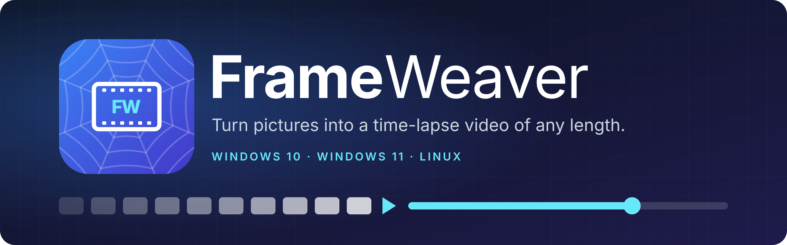

<p align="center">
  
</p>

**FrameWeaver** turns a folder of pictures into a time-lapse video of exactly the length you choose. It's the companion to [SnapLapse](https://github.com/Straconis/SnapLapse): SnapLapse captures a window's pictures on a timer, and FrameWeaver weaves them into a video.

## Download

Get the latest version from the [Releases page](https://github.com/Straconis/FrameWeaver/releases/latest). FFmpeg is included, so there's nothing else to install.

- **Windows 10 / 11:** `FrameWeaver-<version>-setup.exe` installs FrameWeaver into `Program Files\FrameWeaver`, with a FrameWeaver folder in the Start menu and an uninstaller. Or unzip `FrameWeaver-<version>-windows-portable.zip` and run `FrameWeaver.exe`.
- **Linux:** unpack `FrameWeaver-<version>-linux-x86_64.tar.gz` and run `FrameWeaver/frameweaver`.

Windows may show a SmartScreen warning because the app isn't code-signed yet. Choose **More info → Run anyway**.

## How to use it

1. **Choose folder…** for a folder of pictures, such as a SnapLapse recording. **Choose file or ZIP…** takes a picture or a ZIP; for a split ZIP, pick any part.
2. Type the **video length** as hours:minutes:seconds, for example `00:02:00`, or switch to **time per picture**.
3. Pick the **size**, **shape** and how pictures that don't fit are handled, then the **format** and **quality**.
4. Check the summary, which shows the frame math, and press **Create video**.

## Features

- **Open pictures your way:** a folder of pictures, or a SnapLapse recording folder or ZIP, including split ZIPs (part 1, part 2…). Pictures are taken in natural order: 2 comes before 10.
- **Pick the length as HH:MM:SS.** FrameWeaver works out how long each picture stays on screen, spreads the frames evenly, and shows the math before you start. You can set a time per picture instead.
- **Formats:**
  - MP4 (H.264), which plays everywhere.
  - MP4 (H.265), at about half the size.
  - WebM (VP9), an open format.
  - Animated GIF, for short clips.
- **Size and shape:**
  - **Size:** same as the pictures, 720p, 1080p, 1440p, 4K, or custom.
  - **Aspect ratio:** 16:9, 4:3, 1:1, 9:16 vertical, or 21:9.
  - **Fit:** pictures can fit with bars, fill by cropping, or stretch.
- **Frame rate and quality:** 24, 25, 30, 50 or 60 fps, and high, balanced or small file.
- **Progress and cancel** while it works, and one click to open the finished video.
- **Handles window resizing:** if the pictures change size part-way, as when you resize the window during a SnapLapse recording, every picture still gets its exact time.

## Platforms

Windows 10, Windows 11 and Linux (64-bit). Video encoding uses [FFmpeg](https://ffmpeg.org), which is included with every download.

## Command line

`frameweaver --input PICTURES --output video.mp4 --length 00:02:00` makes a video without opening the window. Run `frameweaver --help` for every option.

## Building from source

Everything builds inside a Podman container:

```bash
./build.sh          # Linux and Windows downloads into dist/
./build.sh test     # automated tests and code checks
```

## License

FrameWeaver is [MIT](LICENSE). The bundled FFmpeg is a separate program under the GPL; see [licenses/FFMPEG-NOTICE.txt](licenses/FFMPEG-NOTICE.txt) for its license and source.
